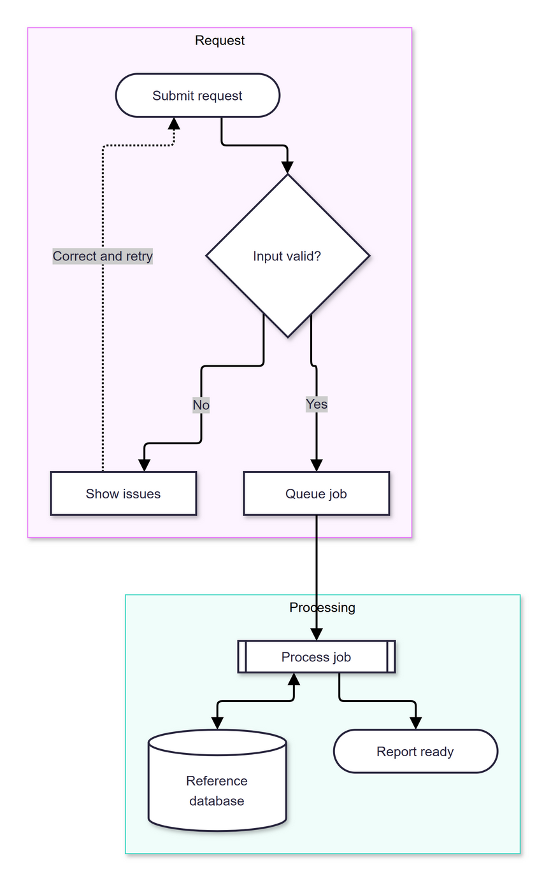
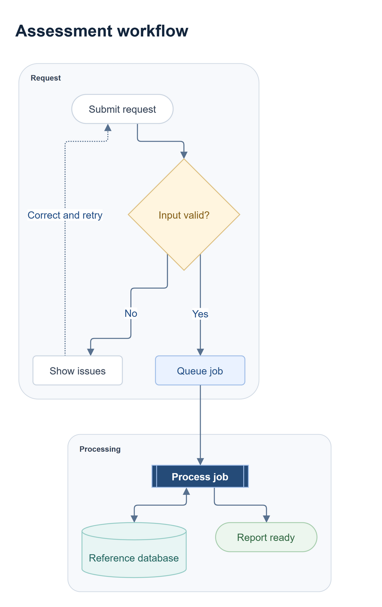

# Mermaid to Draw.io skill

One agent skill with two modes:

- **Faithful (default):** convert Mermaid's rendered flowchart directly into
  editable, uncompressed Draw.io XML, preserving its appearance.
- **Beautify (explicit):** apply typography, spacing and palettes while keeping
  labels, semantic shapes, groups, connections, arrows and dashed links.

Both modes export the final editable `.drawio` through Draw.io desktop and
require inspection of the resulting PNG. They share the same helper and the
containing checkout's dependencies. No second clone or fixed Git revision is
required. Only Mermaid flowcharts are supported.

See [SETUP.md](SETUP.md) for installation, dependencies, CLI examples, configuration
and platform support, and [SKILL.md](SKILL.md) for the agent workflow. The full
workflow is tested on Windows; macOS/Linux discovery is implemented but untested.
The skill, scripts and examples use the repository's [MIT license](LICENSE).

## Examples

Both examples use the same [Mermaid source](examples/workflow.mmd).

Faithful conversion: [editable Draw.io](examples/workflow-faithful.drawio).

Beautified conversion with a title and [palette map](examples/styles.json):
[editable Draw.io](examples/workflow.drawio).

